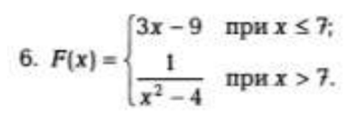
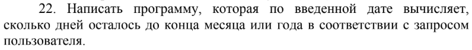
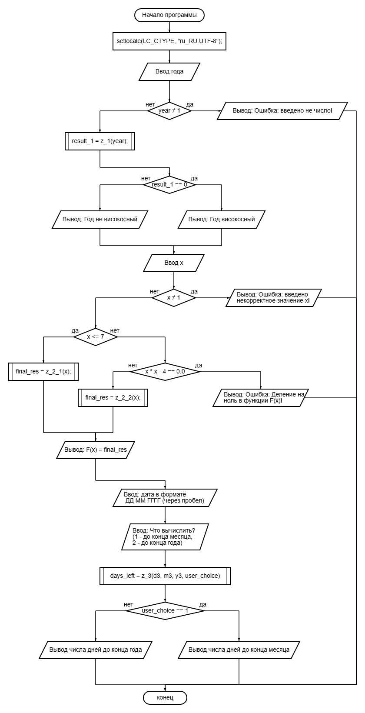
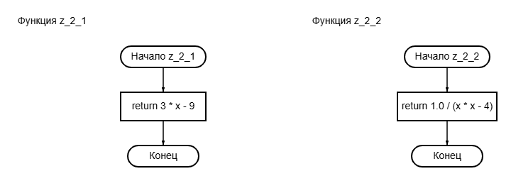
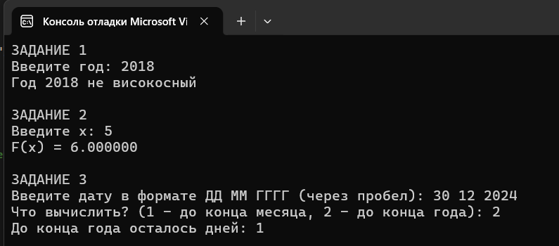

# Лабораторная работа 6

## Цель работы
Получение навыков  использования ветвлений в программах с использованием операторов if-else языка С и закрепления навыков использования арифметических операции 

## Условие задания 2 (вариант 22 (6))

## Условие задания 3 (вариант 22)

## Блок-схема

## Результаты работы программы

## Информация о разработчике
Орлова Эльвира Эдуардовна
Группа: бИД-261
